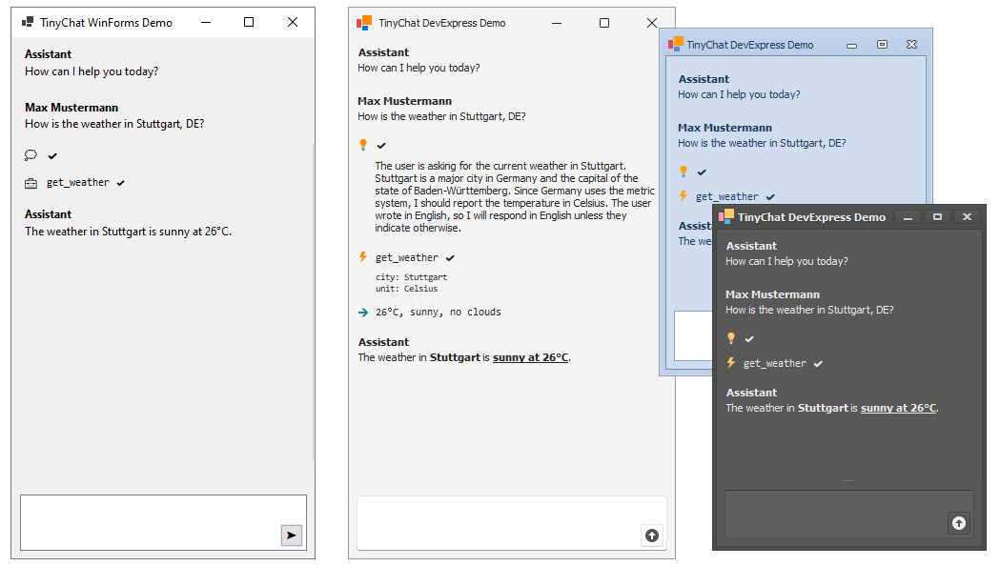

[](https://www.nuget.org/packages/TinyChat/)

# TinyChat 💬

A minimalistic but extensible chat control library for Windows Forms.



## ✨ Features

- **Two control suites**: vendor-control-free Windows Forms controls in `TinyChat` and a skinnable DevExpress implementation in `TinyChat.DevExpress`
- **Streaming support**: real-time message streaming for AI assistants and live conversations
- **Microsoft.Extensions.AI integration**: use any registered `IChatClient`, including keyed services, with streaming, cancellation, chat options, reasoning, and function calls
- **File and image attachments**: add files through drag and drop, clipboard paste, or the public API; images are shown as previews
- **Selectable and copyable content**: directly select regular message text, function-call arguments and results, or reasoning details, or copy any complete message with its hover button
- **Designer-friendly appearance**: configure fonts, colors, history, message and input spacing, welcome alignment, the splitter, and behavioral options in the Windows Forms Designer
- **New-chat lifecycle**: cancel the active response and clear the conversation and input draft in one call
- **Readable message rendering**: native controls use cleaned plain text, while the DevExpress suite keeps its safe HTML/CSS formatting in a permanently selectable message surface
- **Extensible architecture**: interface-driven design and factory methods for custom message types and UI components

## Control suites

| NuGet package | Control | UI components | Default formatter |
|---|---|---|---|
| `TinyChat` | `ChatControl` | Native Windows Forms controls | `PlainTextMessageFormatter` |
| `TinyChat.DevExpress` | `DXChatControl` | DevExpress controls | `SimplifiedHtmlMessageFormatter` (selectable HTML/CSS body view) |

Both controls share the same public chat API. `DXChatControl` derives from `ChatControl` and replaces the primary editors, message controls, history, welcome surface, and splitter with DevExpress counterparts.
`TinyChat.DevExpress` is built and tested with DevExpress 24.2.12 and requires the corresponding DevExpress license.

## 💖 Motivation

While there are countless web-based chat controls, there are very few for the good old Windows Forms ecosystem. TinyChat provides a focused user interface for interacting with AI models inside an existing WinForms application.

DevExpress also offers a feature-rich [AI Chat Control](https://docs.devexpress.com/WindowsForms/405218). It is based on web technologies and therefore [adds a significant set of deployment dependencies](https://supportcenter.devexpress.com/ticket/details/t1294891/aichatcontrol-without-webview). TinyChat deliberately stays smaller and exposes factory methods and interfaces for applications that need to customize it.

## Known limitations

- **Full formatting specifications are not implemented.** Native Windows Forms message controls display cleaned plain text. The DevExpress controls support a practical subset of common HTML and Markdown constructs, but not every HTML, Markdown, or RTF feature an assistant may emit.
- **Image rendering currently focuses on attachments.** Local or pasted images have previews and are sent to compatible `IChatClient` implementations as multimodal content. Arbitrary remote images or image content returned by an assistant are not rendered automatically.
- **Provider capabilities still apply.** A provider or model may reject a binary attachment format even though TinyChat can load and forward it. Override `ConvertFileAttachment()` when files need extraction, upload, or RAG processing first.

## 🚀 Quick start

### Native Windows Forms

```csharp
using TinyChat;

var chatControl = new ChatControl
{
    Dock = DockStyle.Fill
};
Controls.Add(chatControl);
```

For the DevExpress suite, reference `TinyChat.DevExpress` and instantiate `DXChatControl` instead. The remaining API is the same.

### Basic message handling

The `Messages` property supplies an existing conversation. `MessageSending` can inspect or cancel a user message, while `MessageSent` runs after it was accepted.

```csharp
chatControl.MessageSent += (_, e) =>
{
    Console.WriteLine($"User sent: {e.Content}");

    chatControl.AddMessage(
        new NamedSender("Assistant"),
        new StringMessageContent("Hello! How can I help you?"));
};
```

### Starting a new chat

Use `StartNewChat()` instead of assigning an empty message collection. It requests cancellation of an active response and clears the built-in conversation, text draft, pending attachments, selection, and copy UI in one call.

```csharp
chatControl.NewChatStarted += (_, _) =>
{
    // Reset any application-specific session state here.
};

chatControl.StartNewChat();
```

Custom input controls can implement `IChatInputDraftControl` so their own draft state is cleared by the same call.

### Designer and appearance settings

The following properties are available in the Windows Forms Designer and work for both control suites:

```csharp
chatControl.MessageFont = new Font("Segoe UI", 10f);
chatControl.InputFont = new Font("Segoe UI", 10f);
chatControl.WelcomeFont = new Font("Segoe UI", 14f);
chatControl.WelcomeMessage = "How can I help?";
chatControl.HistoryPadding = new Padding(12);
chatControl.MessagePadding = new Padding(10);
chatControl.MessageMargin = new Padding(4);
chatControl.InputPadding = new Padding(10);
chatControl.WelcomeTextAlign = ContentAlignment.MiddleCenter;
chatControl.IsSplitterFixed = true;
chatControl.SplitterPosition = 90;
```

`Font`, `ForeColor`, and `BackColor` provide the global appearance for the complete chat and are propagated by both the native Windows Forms and DevExpress suites. `MessageFont` and `InputFont` inherit from `Font` until explicitly changed; resetting them resumes that inheritance. `WelcomeFont` is independent, and resetting it restores the larger default welcome font.

The layout properties have the same meaning and defaults in both suites:

| Property | Scope | Default after reset |
|---|---|---|
| `HistoryPadding` | Padding inside the history area, including the welcome surface | `0` on every side |
| `MessagePadding` | Inner padding of regular, function-call, and reasoning messages | `8` on every side |
| `MessageMargin` | Outer margin of every message | `3` on every side |
| `InputPadding` | Inner padding of the complete input area | `8` on every side |
| `WelcomeTextAlign` | Alignment of the welcome text within the history area | `ContentAlignment.MiddleCenter` |
| `IsSplitterFixed` | Prevents the user from moving the splitter when enabled | `false` |
| `SplitterPosition` | Height of the lower input area in pixels | `60` |

Resetting one of these properties in the Designer restores the listed value. The inherited `ChatControl.Padding` property remains the outer padding around the combined chat surface; it is not inherited by the history, messages, or input area.

### Selecting and copying text

Both control suites display regular message bodies permanently in selectable text views. Drag directly over the required text and press <kbd>Ctrl</kbd>+<kbd>C</kbd>; no renderer or selection-mode switch is required. Starting a selection in another message clears the previous selection, so multiple message bodies are never highlighted at the same time.

Function-call arguments and results as well as reasoning details are directly selectable in the same way. To copy the complete content of any message, hover over it and use the copy button. You can also click the sender/header or message background and press <kbd>Ctrl</kbd>+<kbd>C</kbd> to copy the complete message.

### File and image attachments

When `AllowFileAttachments` is enabled (the default), users can:

- drop files anywhere on the chat;
- paste copied files or a bitmap into the input;
- remove attachments from the draft before sending;
- see small image previews and document tiles.

The default per-file limit is 20 MiB and can be changed with `MaximumAttachmentFileSize`. Files can also be supplied in code:

```csharp
await chatControl.AddFilesToInputAsync(openFileDialog.FileNames);

await chatControl.SendFilesAsync(
    ["report.pdf", "diagram.png"],
    "Summarize these files.");
```

Text attachments are forwarded as named text sections. Images and other binary files are represented as typed `DataContent` for `Microsoft.Extensions.AI`.

### Streaming messages with `IAsyncEnumerable`

Pass a token stream to `AddStreamingMessage()`. TinyChat marshals display updates back to the UI synchronization context.

```csharp
IAsyncEnumerable<string> stream = GetTokenStream();
chatControl.AddStreamingMessage(new NamedSender("AI Assistant"), stream);
```

### Using `IChatClient` with dependency injection

TinyChat can resolve and call a `Microsoft.Extensions.AI.IChatClient` automatically.

```csharp
using Microsoft.Extensions.AI;
using Microsoft.Extensions.DependencyInjection;
using TinyChat;

var services = new ServiceCollection();
services.AddSingleton<IChatClient>(CreateChatClient());

var chatControl = new ChatControl
{
    ServiceProvider = services.BuildServiceProvider(),
    UseStreaming = true,
    AssistantSenderName = "AI Assistant"
};
```

The complete conversation is converted and passed to the client. Override `ConvertToChatMessages()` or `DetermineChatRole()` when the default sender-to-role mapping does not fit your application. `ChatOptions`, `ChatOptionsRequested`, `IncludeFunctionCalls`, and `IncludeReasoning` customize each request and its visualization.

Keyed clients are supported as well:

```csharp
services.AddKeyedSingleton<IChatClient>("basic", CreateBasicClient());
services.AddKeyedSingleton<IChatClient>("premium", CreatePremiumClient());

chatControl.ChatClientServiceKey = "premium";
```

### Formatting

Both suites use a permanently visible message surface so that text can always be selected without changing renderers. `ChatControl` uses a read-only native `TextBox` and `PlainTextMessageFormatter` to remove common HTML and Markdown syntax while keeping the text readable.

`DXChatControl` uses a permanent DevExpress `HtmlContentControl`. It combines formatted rendering with native DevExpress text selection, automatic height calculation, and stable streaming updates in the same control. `SimplifiedHtmlMessageFormatter` remains the default; its supported bold, italic, underline, strike-through, heading, color, code-font, paragraph, line-break, and link output is converted to a safe HTML/CSS-template subset before rendering. Remote images and unsafe link schemes are not injected into message templates.

Function-call arguments and results as well as reasoning details use the same selectable DevExpress HTML surface, with their plain text HTML-encoded before display.

To customize normalization and rendering, implement `IMessageFormatter` and override `CreateDefaultMessageFormatter()`.

## 🎬 Demos

`DemoApp` contains both native Windows Forms and DevExpress examples, including direct `IChatClient` integration:

```bash
dotnet run --project DemoApp
```

## Credits

The package icon was made by [Vectors Market](https://www.flaticon.com/authors/vectors-market) and is licensed under the [Flaticon license](https://www.flaticon.com/legal).
