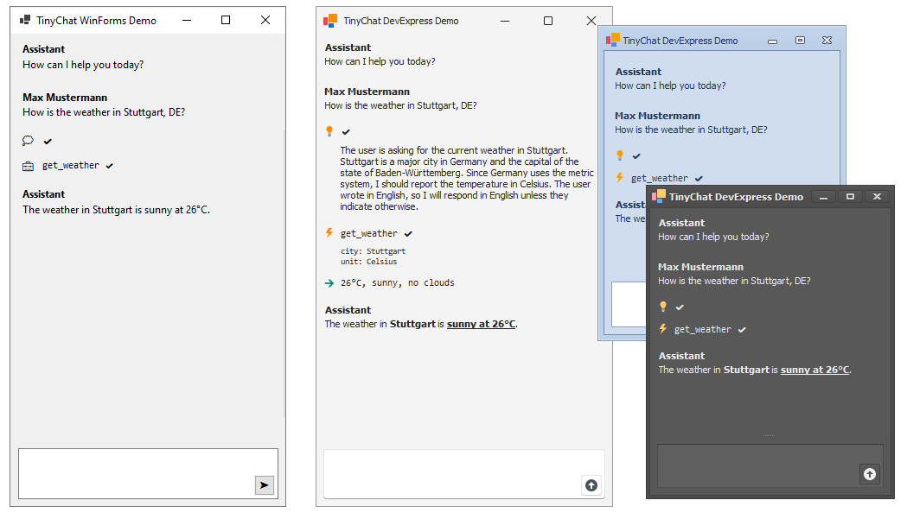

[](https://www.nuget.org/packages/TinyChat/)

# TinyChat 💬

A minimalistic but extensible chat control library for Windows Forms.



## ✨ Features

- **Two control suites**: vendor-control-free Windows Forms controls in `TinyChat` and a skinnable DevExpress implementation in `TinyChat.DevExpress`
- **Streaming support**: real-time message streaming for AI assistants and live conversations
- **Microsoft.Extensions.AI integration**: use any registered `IChatClient`, including keyed services, with streaming, cancellation, chat options, reasoning, and function calls
- **File and image attachments**: add files through drag and drop, clipboard paste, or the public API; images are shown as previews
- **Message actions**: a small icon bar on every message offers copying (plain text, or with formatting in the DevExpress suite) and going back to that message
- **Designer-friendly appearance**: configure fonts, colors, history, message and input spacing, welcome alignment, the splitter, and behavioral options in the Windows Forms Designer
- **New-chat lifecycle**: cancel the active response and clear the conversation and input draft in one call
- **Readable message rendering**: native controls use cleaned plain text, while the DevExpress suite renders the formatting supported by its label controls
- **Extensible architecture**: interface-driven design and factory methods for custom message types and UI components

## Control suites

| NuGet package | Control | UI components | Default formatter |
|---|---|---|---|
| `TinyChat` | `ChatControl` | Native Windows Forms controls | `PlainTextMessageFormatter` |
| `TinyChat.DevExpress` | `DXChatControl` | DevExpress controls | `SimplifiedHtmlMessageFormatter` (DevExpress HTML-inspired label formatting) |

Both controls share the same public chat API. `DXChatControl` derives from `ChatControl` and replaces the primary editors, message controls, history, welcome surface, and splitter with DevExpress counterparts.
`TinyChat.DevExpress` is built and tested with DevExpress 25.2.9 and requires the corresponding DevExpress license.

## 💖 Motivation

While there are countless web-based chat controls, there are very few for the good old Windows Forms ecosystem. TinyChat provides a focused user interface for interacting with AI models inside an existing WinForms application.

DevExpress also offers a feature-rich [AI Chat Control](https://docs.devexpress.com/WindowsForms/405218). It is based on web technologies and therefore [adds a significant set of deployment dependencies](https://supportcenter.devexpress.com/ticket/details/t1294891/aichatcontrol-without-webview). TinyChat deliberately stays smaller and exposes factory methods and interfaces for applications that need to customize it.

## Known limitations

- **Full formatting specifications are not implemented.** Native Windows Forms message controls display cleaned plain text. The DevExpress controls support a practical subset of common HTML and Markdown constructs, but not every HTML, Markdown, or RTF feature an assistant may emit.
- **Images require a compatible client and model.** Local and pasted images, image content in responses, and images in restored history or structured tool results are displayed as previews. Arbitrary remote Markdown images are not downloaded automatically.
- **Provider capabilities still apply.** A client or model may reject or omit a binary attachment format even though TinyChat supplies it as `DataContent`. Register an `IAttachmentContentProvider` when files need extraction, upload, or RAG processing first. In particular, Ollama chat accepts images, not arbitrary PDF or Office binaries.

## 🚀 Quick start

### Native Windows Forms

```csharp
using TinyChat;

var chatControl = new ChatControl
{
    Dock = DockStyle.Fill
};
Controls.Add(chatControl);
```

For the DevExpress suite, reference `TinyChat.DevExpress` and instantiate `DXChatControl` instead. The remaining API is the same.

### Basic message handling

The `Messages` property supplies an existing conversation. `MessageSending` can inspect or cancel a user message, while `MessageSent` runs after it was accepted.

```csharp
chatControl.MessageSent += (_, e) =>
{
    Console.WriteLine($"User sent: {e.Content}");

    chatControl.AddMessage(
        new NamedSender("Assistant"),
        new StringMessageContent("Hello! How can I help you?"));
};
```

### Starting a new chat

Use `StartNewChat()` instead of assigning an empty message collection. It requests cancellation of an active response and clears the built-in conversation, text draft, and pending attachments in one call.

```csharp
chatControl.NewChatStarted += (_, _) =>
{
    // Reset any application-specific session state here.
};

chatControl.StartNewChat();
```

Custom input controls can implement `IChatInputDraftControl` so their own draft state is cleared by the same call.

### Designer and appearance settings

Fonts, colours, paddings, the welcome text, the splitter and the visibility of function calls, skills and reasoning can be set in the Windows Forms Designer for both control suites. Changes apply to existing messages as well.

### Message actions

When the pointer rests over a message, a small icon bar appears on its top-right edge:

- **Copy**: copies the message as plain text, with Markdown and HTML removed.
- **Copy with formatting** (`DXChatControl` only): copies the message as HTML together with its plain text, so bold text, colours, links and line breaks are kept when pasting into Word, Outlook or OneNote.
- **Go back**: permanently rewinds the conversation. Every later message is removed and is no longer sent to the `IChatClient`. When the message is an assistant response, it stays and the input is cleared. When the message was sent by the user, it is removed as well and its text and attachments are placed in the input, ready to be edited and sent again. This button is not offered while a response is being received.

The bar only shows icons: the native suite uses the Windows icon font like the tool-call icons, the DevExpress suite uses Fluent UI System Icons. You can also click the sender/header or message body and press <kbd>Ctrl</kbd>+<kbd>C</kbd> to copy the complete message.

Use `ShowMessageActions` and `MessageActionsHoverDelay` to configure the bar. `RevertToMessage()` performs the revert in code, returns `false` while `IsBusy`, and raises `ConversationReverted` with the removed messages. Override `GetMessageActions()` to add or remove buttons (custom actions use `ChatMessageActionKind.Custom` with an `Image`), `CreateMessageActionButton()` to change their look, and `IsUserMessage()` to change which messages are treated as user messages. Custom input controls implement `IChatInputDraftEditorControl` to receive the reverted draft.

### File and image attachments

When `AllowFileAttachments` is enabled (the default), users can:

- drop files anywhere on the chat;
- paste copied files or a bitmap into the input;
- remove attachments from the draft before sending;
- see compact image previews and file icons with tooltips.

The default per-file limit is 20 MiB and can be changed with `MaximumAttachmentFileSize`. Files can also be supplied in code:

```csharp
await chatControl.AddFilesToInputAsync(openFileDialog.FileNames);

await chatControl.SendFilesAsync(
    ["report.pdf", "diagram.png"],
    "Summarize these files.");
```

Text attachments are forwarded as named text sections. Images and other binary files are represented as typed `DataContent` for `Microsoft.Extensions.AI`.

### Attachment conversion providers

Both controls use the same ordered `AttachmentContentProviders` collection. The first matching `IAttachmentContentProvider` wins: the defaults handle text, images, and finally arbitrary binary data. Insert custom converters before the binary fallback. To reject unsupported binary formats, remove the `BinaryAttachmentContentProvider`; rejected files are marked in the input area. Warnings and errors appear on the affected attachment, with details in its tooltip.

UI text and tooltips use localized defaults (English/German). Hosts can customize `DisplayTexts` in the designer and supply `NoticeTextProvider` for their own text catalog.

#### Optional PDF and Office extraction: copy the source examples

`TinyChat.DevExpress` does **not** reference `DevExpress.Document.Processor` or register document extraction automatically. A WinForms subscription must not be assumed to include the [Office File API license](https://docs.devexpress.com/OfficeFileAPI/14911/office-file-api?v=25.2). Check the license for the APIs you use; DevExpress documents Office File API and Universal subscriptions for this product.

The following are **source examples**, not an additional TinyChat package. Copy the shared base class and whichever providers you need into your application, adapt them to your requirements, and choose your own namespace:

| Source class | Purpose |
|---|---|
| [DevExpressDocumentContentProvider](samples/DocumentAttachmentProviders/DevExpressDocumentContentProvider.cs) | Shared background conversion, cancellation checks, text limit, and attachment notices |
| [SpreadsheetAttachmentContentProvider](samples/DocumentAttachmentProviders/SpreadsheetAttachmentContentProvider.cs) | Excel worksheets as named CSV text sections; optional formula expressions |
| [WordAttachmentContentProvider](samples/DocumentAttachmentProviders/WordAttachmentContentProvider.cs) | Plain text from Word, RTF, and ODT documents |
| [PdfAttachmentContentProvider](samples/DocumentAttachmentProviders/PdfAttachmentContentProvider.cs) | PDF text grouped by page |

For these examples, reference `DevExpress.Document.Processor` **in your application only**, with a compatible DevExpress version and license. The source is tested with 25.2.9, .NET 9/10, nullable reference types, and implicit usings enabled. Other extraction libraries can implement the same [IAttachmentContentProvider](TinyChat/Attachments/IAttachmentContentProvider.cs) contract without using DevExpress.

After copying the classes, register them before adding files (works with `ChatControl` and `DXChatControl`):

```csharp
using TinyChat;
using TinyChat.Samples.DocumentAttachments; // Or the namespace chosen in your application.

chatControl.AttachmentContentProviders.Insert(0, new PdfAttachmentContentProvider());
chatControl.AttachmentContentProviders.Insert(0, new WordAttachmentContentProvider());
chatControl.AttachmentContentProviders.Insert(0,
    new SpreadsheetAttachmentContentProvider(includeFormulas: true));

// Optional: accept only formats handled by a configured text/image/document provider.
var binaryFallback = chatControl.AttachmentContentProviders
    .OfType<BinaryAttachmentContentProvider>().Single();
chatControl.AttachmentContentProviders.Remove(binaryFallback);

// Without registration, PDF/Office files use the binary fallback.
// Actual binary transport and interpretation depend on IChatClient and the model.
```

These examples extract **text**, with a default limit of 200,000 characters per document and a truncation notice. Excel extraction iterates all worksheets, including hidden sheets, and each sheet's data range; later sheets can fall beyond the document limit. It uses formatted cell text and optionally formula expressions; it does not explicitly recalculate formulas, run macros, or extract charts or embedded images. Word formatting/layout and PDF images are not retained. Scanned PDFs need a separate OCR implementation. Empty or unreadable documents raise attachment errors; password handling is not implemented. Cancellation is checked around library calls and during iteration; a running synchronous document load cannot be interrupted immediately.

Licensed contributors can compile and test the exact sample sources explicitly; the normal solution build and tests exclude them:

```shell
dotnet test Tests/Tests.csproj -c Release -p:TestDocumentAttachmentSamples=true --filter FullyQualifiedName~DocumentAttachmentProviderSampleTests
```

### Streaming messages with `IAsyncEnumerable`

Pass a token stream to `AddStreamingMessage()`. TinyChat marshals display updates back to the UI synchronization context.

```csharp
IAsyncEnumerable<string> stream = GetTokenStream();
chatControl.AddStreamingMessage(new NamedSender("AI Assistant"), stream);
```

### Using `IChatClient` with dependency injection

TinyChat can resolve and call a `Microsoft.Extensions.AI.IChatClient` automatically.

```csharp
using Microsoft.Extensions.AI;
using Microsoft.Extensions.DependencyInjection;
using TinyChat;

var services = new ServiceCollection();
services.AddSingleton<IChatClient>(CreateChatClient());

var chatControl = new ChatControl
{
    ServiceProvider = services.BuildServiceProvider(),
    UseStreaming = true,
    AssistantSenderName = "AI Assistant"
};
```

The complete conversation is converted and passed to the client. Override `ConvertToChatMessagesAsync()` or `DetermineChatRole()` when the default sender-to-role mapping does not fit your application. `ChatOptions` and `ChatOptionsRequested` customize each request; `IncludeFunctionCalls` and `IncludeReasoning` control whether the corresponding captured response details are visible.

Errors returned as `ErrorContent`, including AG-UI run errors, raise `ErrorOccurred` and appear as a System error message in both streaming and non-streaming responses. Set `Handled = true` on the event to suppress the default message. Error content does not stop the response; any subsequent content is still processed.

Keyed clients are supported as well:

```csharp
services.AddKeyedSingleton<IChatClient>("basic", CreateBasicClient());
services.AddKeyedSingleton<IChatClient>("premium", CreatePremiumClient());

chatControl.ChatClientServiceKey = "premium";
```

### Formatting

`ChatControl` uses native labels and `PlainTextMessageFormatter` to remove common HTML and Markdown syntax while keeping the text readable.

`DXChatControl` uses DevExpress `LabelControl`s with [HTML-inspired text formatting](https://docs.devexpress.com/WindowsForms/4874/common-features/html-text-formatting). `SimplifiedHtmlMessageFormatter` is the default and converts Markdown and HTML into the supported bold, italic, underline, strike-through, colour, size, code-font, paragraph, line-break and link tags.

Both suites preserve Unicode emoji, including multi-code-point sequences. Their exact colour and glyph style still depend on the installed Windows fonts and the active renderer; native Windows Forms commonly displays monochrome glyphs.

To customize normalization and rendering, implement `IMessageFormatter` and override `CreateDefaultMessageFormatter()`.

## Versioning

The publishing workflow calculates the version with GitVersion from Git history and tags, and passes the same version to build and pack for both packages. Release versions are not stored in the project files or in a `next-version` setting.

Use a commit-message marker to request an increment ([GitVersion documentation](https://gitversion.net/5.12.0/docs/reference/version-increments)):

```text
Add extensible attachment conversion

+semver: minor
```

Use `+semver: patch` for a patch or `+semver: major` for a major release. Preserve the marker in the final commit message when squashing or merging. For local release packages, pass the same GitVersion-derived value as `Version` when building and `PackageVersion` when packing; an ordinary local build without an injected version uses the .NET SDK default. Application package references still select a concrete released package version.

## 🎬 Demos

`DemoApp` contains both native Windows Forms and DevExpress examples, including direct `IChatClient` integration:

```bash
dotnet run --project DemoApp
```

## Credits

The package icon was made by [Vectors Market](https://www.flaticon.com/authors/vectors-market) and is licensed under the [Flaticon license](https://www.flaticon.com/legal).

The DevExpress controls use icons from the [Fluent UI System Icons](https://github.com/microsoft/fluentui-system-icons) by Microsoft, licensed under the [MIT License](https://github.com/microsoft/fluentui-system-icons/blob/main/LICENSE).
